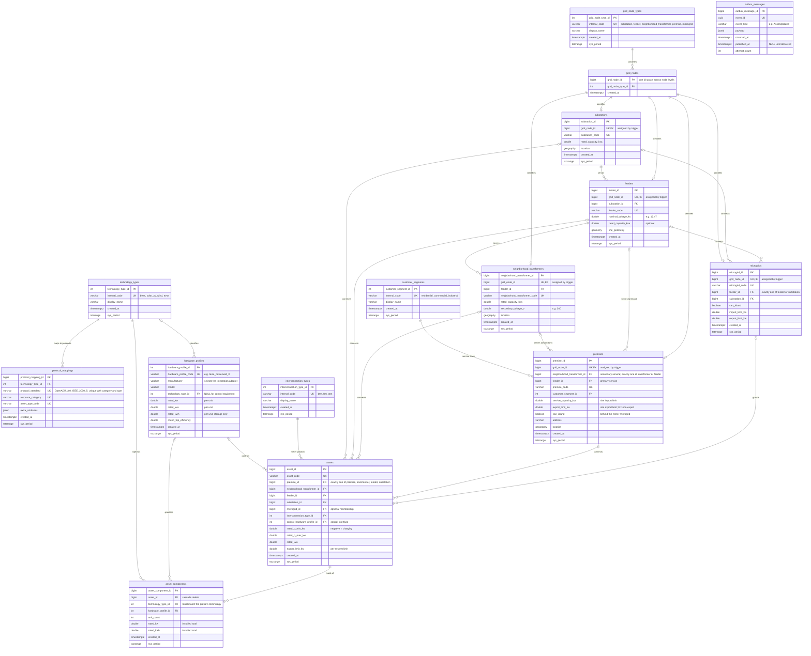
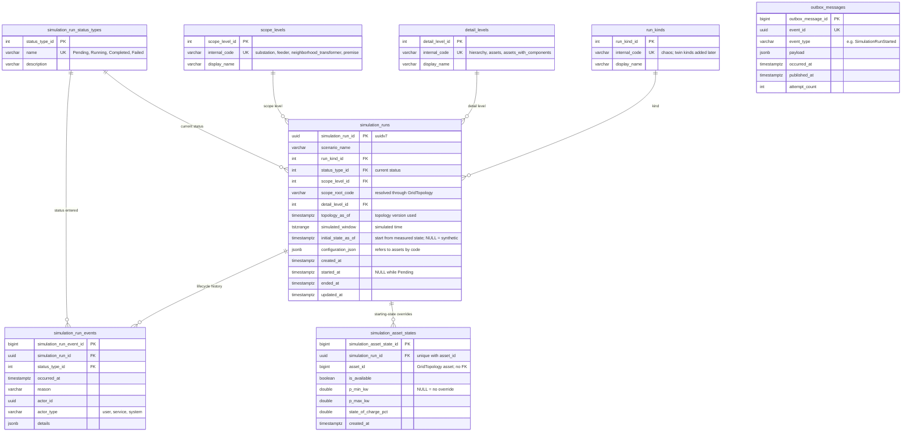
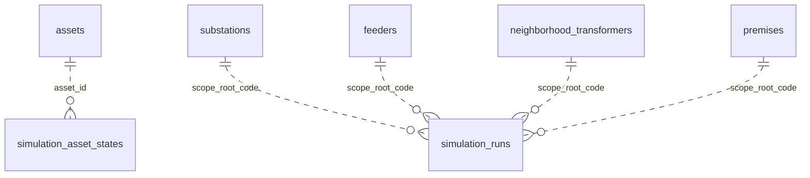

# Data Model: `rva_core`

Entity-relationship diagrams for `infrastructure/postgres/core/rva_core_init.sql`, the core database's schema. Each backend module owns one schema, and **no foreign keys cross schemas**, so each schema has its own diagram. A third diagram shows the references between modules, which are plain IDs and codes checked by the owning module's contracts.

The DDL is the source of truth. Update this page in the same pull request whenever the schema changes.

**Notation:** `||` exactly one, `|o` zero or one, `o{` zero or more. A solid line is a foreign key; a dotted line is a reference with no foreign key. Column types are simplified: `varchar` lengths, `geography(Point, 4326)`, and `geometry(LineString, 4326)` are shortened.

## `topology` schema (GridTopology module)

**Rules the diagram can't show:**
- **Connection points:** an asset connects at exactly one of a premise, neighborhood transformer, feeder, or substation; a premise at exactly one of a neighborhood transformer (secondary service) or feeder (primary service); a microgrid at exactly one of a feeder or substation (`CHECK` constraints). Parent links record the normal configuration, not the energized path.
- **Grid node identity:** inserting a substation, feeder, neighborhood transformer, premise, or microgrid creates its `grid_nodes` row by trigger, of the matching type. `grid_node_id` can't be changed, and `grid_nodes` rejects `UPDATE` and `DELETE`, so a removed node's id stays registered for data that refers to it.
- **Components and profiles:** `asset_components (hardware_profile_id, technology_type_id)` is a composite foreign key, so a component can only use an energy product of its own technology, never control-only equipment.
- **Asset power:** an asset's real power can't exceed its kVA rating.
- **Versioning:** every table above except `grid_nodes` (never changes) and `outbox_messages` is system-versioned by `topology.enable_versioning`. Each has a `<table>_history` twin with the same columns (matched by name) plus `operation`, `changed_by` (UUID), `actor_type`, and `change_reason`, and a `<table>_as_of(point_in_time)` function. The 13 history tables are left out of the diagram, since each mirrors its main table.
- **Rules enforced in C# instead:** transformer-, feeder-, and substation-connected assets are `ftm`; an asset has at least one component; microgrid members sit under the microgrid's own feeder.

## `simulation` schema (Simulation module)

**Rules the diagram can't show:**
- **Run events are written by trigger** whenever a run is created or changes status, and the table rejects `UPDATE` and `DELETE`. Because events reference their run, a run with events can't be deleted.
- **Run inputs are fixed:** `run_kind_id`, `topology_as_of`, `initial_state_as_of`, and `created_at` can't change after creation, and overrides can't be inserted, changed, or deleted once a run leaves `Pending`.
- **Overrides are starting state only,** at most one per asset per run. Changes during a run belong in `configuration_json` or a future per-run event table.
- **Timestamps:** `started_at >= created_at`, `ended_at` after both (a run can fail before it starts), and `topology_as_of` and `initial_state_as_of` are no later than `created_at`.

## References between modules (no foreign keys)

Simulation stores these references as plain values. `CreateRun` checks them through `IGridTopologyQueries`: it validates the scope root against the topology version given by `topology_as_of`, and turns override `asset_code`s into `asset_id`s. Telemetry's tables live in a separate database (`rva_telemetry`) and refer to `asset_id` the same way.
