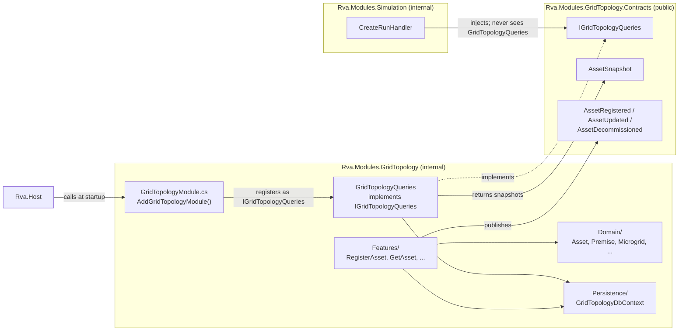

# Module Contracts

How one module uses another without seeing its internals. A module's `.Contracts` project is its **public API**. It **defines** the interfaces, snapshots, and events; the module implementation **implements** them; `Rva.Host` connects the two at runtime through dependency injection.

The example below shows Simulation using GridTopology.

## What goes in a `.Contracts` project

| Kind | Purpose | GridTopology example |
|---|---|---|
| Query interfaces | In-process reads that must be current, including safety-critical ones | `IGridTopologyQueries` |
| Snapshot records | Immutable, read-only copies of data returned by queries; never entities | `AssetSnapshot`, `ProtocolMappingSnapshot` |
| Integration events | Change notifications for modules that keep a local copy of the data | `AssetRegistered`, `AssetUpdated`, `AssetDecommissioned` |

**What stays out:** entities and domain logic, the DbContext and persistence code, feature request/response DTOs, and anything no other module needs.

## Rules

- **The dependency points one way.** The module references its contracts; the contracts never reference the module. A reference back would be circular and would expose the module's internals.
- **A `.Contracts` project references only `Rva.SharedKernel`.** That is why snapshots use shared types like `AssetId` and `Kilowatts`.
- **Each module owns and versions its contracts.** Changing an implementation affects no other module unless the contract changes.

## Contracts vs. feature endpoints

A feature handler and a contract implementation may share the same internal logic, but they serve different callers:

| | Feature endpoint (`Features/GetAsset/`) | Contract (`IGridTopologyQueries`) |
|---|---|---|
| Called by | External clients over HTTP (`Rva.Simulator`, the future dashboard) | Other modules, in the same process |
| Shape | Request/response DTOs local to the feature | Snapshot records from `.Contracts` |
| Lives in | The module implementation | Defined in `.Contracts`, implemented in the module |

## The GridTopology contract

`IGridTopologyQueries` (`Rva.Modules.GridTopology.Contracts`) as of plan step `p1-s01d`. The topology snapshot (`GetTopologySnapshot`, `p1-s01g`) is added by a later part. Every method takes an optional `asOf` (null = current; a future time is a Validation error, `GridTopology.AsOfInFuture`) and a `CancellationToken`, returns `Task<Result<T>>`, and reads `rva_core` on every call, never a cache. A database failure is an exception to the caller, never a `Result`.

| Method | Returns | Expected failures |
|---|---|---|
| `ResolveTechnologyTypeAsync(standard, resourceCategory, assetTypeCode, asOf)` | `TechnologyTypeCode` | `ProtocolMappingNotFound`, `ProtocolMappingQueryInvalid` |
| `GetProtocolMappingsAsync(standard, asOf)` | `IReadOnlyList<ProtocolMappingSnapshot>` | `ProtocolMappingQueryInvalid` |
| `GetAssetAsync(assetId, asOf)` | `AssetSnapshot` | `AssetNotFound` (also before the asset existed), `ConstraintPathIncomplete` |
| `GetAssetsBySubstationAsync(substationCode, asOf, cursor, pageSize)` | `AssetPage` | `SubstationNotFound`, `PageCursorInvalid`, `PageSizeInvalid` (1 to `MaxAssetPageSize` = 1000), `ConstraintPathIncomplete` |
| `GetConstraintPathAsync(assetId, asOf)` | `ConstraintPathSnapshot` | `AssetNotFound`, `ConstraintPathIncomplete` |
| `ResolveNodeAsync(level, code, asOf)` | `GridNodeRef` | `NodeNotFound` (including a code that exists only at another level), `NodeQueryInvalid` |
| `GetGridStateAsync(assetId, asOf)` | `GridStateSnapshot` | `AssetNotFound`, `ConstraintPathIncomplete` |

**Snapshots** (`Contracts/Snapshots/`). Ratings use the shared units and the sign convention (positive = export or discharge). Lifecycle, participation, levels, and makeup are string codes, not enums.

- **`GridNodeRef`**: `GridNodeId`, `Level` (one of `GridNodeLevels`: `substation`, `feeder`, `neighborhood_transformer`, `premise`, `microgrid`), `Code`. Codes are unique within a level only.
- **`AssetSnapshot`**: id and code; `Connection` (the node it connects to) and its substation id and code; interconnection type; `RatedPMinKw`, `RatedPMaxKw`, `RatedKva`, the per-system `ExportLimitKw`; `Site` and `Microgrid` (below); `Makeup` (`pv`, `storage`, `pv_storage`, `other`; null when no components are recorded) and `EnergyCapacityKwh` (null when no component records one); `ControlManufacturer` (null without a control profile); `LifecycleState`; `ParticipationState`; `ValidFrom` (when this version of the asset row took effect).
- **`SiteSnapshot`**: the premise, its `CustomerSegment`, `ServiceCapacityKva` (import limit), `ExportLimitKw`, `CanIsland`. Null for an asset connected above the meter.
- **`MicrogridSnapshot`**: the microgrid, its PCC `ImportLimitKw` and `ExportLimitKw`, `CanIsland`. Null when the asset is not a member.
- **`ConstraintPathSnapshot`**: `Nodes`, the connection node first and the substation last, each a `ConstraintNodeSnapshot` (`Node`, `RatedCapacityKva`, `IsRated`); a premise's rating is its service capacity. Also `Site`, `Microgrid`, and two per-asset limits, both non-negative magnitudes in kW. `EffectiveExportLimitKw` is the minimum of `p_max`, the asset export limit, the site export limit, and the microgrid export limit. `EffectiveImportLimitKw` is the minimum of `|p_min|`, the site service capacity, and the microgrid import limit. Node ratings are shared by everything below the node, so dispatch allocates them; they are not folded into these limits.
- **`GridStateSnapshot`**: `AssetId`, `AssetCode`, `State` (one of `GridStates`: `connected_energized`, `connected_deenergized`, `islanded`, `disconnected`), `CauseNode` (the node whose event gave the asset this state, or null), `CauseAsset` (the asset itself when its own disconnect did, or null), and `IsRegistryEligible`: commissioned, participation `active`, and energized (`connected_energized` or `islanded`). Real-time availability comes from telemetry and is checked separately. The state is derived from the latest event known at `asOf` (occurred and recorded by then) on each node of the asset's path, walked from the substation down (substation, feeder, microgrid, transformer, premise): a de-energized or disconnected node de-energizes everything below it, an islanded node re-energizes what is below it, and a `connected_energized` event never re-energizes below a dead node. The asset's own `disconnected` overrides its path. When several nodes bear on the state, `CauseNode` is the last one on that walk that set it, the one nearest the asset. `pg_temp.asset_grid_states` and `pg_temp.dispatch_eligible` in the pgTAP helpers are the executable spec.
- **`AssetPage`**: `Assets` in asset id order, `AsOf`, `NextCursor` (null on the last page). The first page pins `AsOf`, to the database clock when none is given, and every later page reads that same version, so a listing taken while the topology changes is complete and has no duplicates.

**Rules callers rely on:**

- **Null is not zero.** A null site or microgrid limit means none is recorded at that level; 0 is a limit (non-export).
- **An unrated feeder is never unconstrained.** It has `IsRated = false` and a null rating; treat it as unknown.
- **A path is never missing a level.** When the stored topology cannot complete one at the requested time, the read fails with `GridTopology.ConstraintPathIncomplete`. The module logs this at Error, because it means corrupt data and is never the caller's fault, and an endpoint answers 500.
- **Never cache a constraint path.** A premise reparenting changes it (GT-09).
- **Grid state is never guessed.** A database failure is an exception and an incomplete path is `ConstraintPathIncomplete`; neither is ever reported as energized or eligible (U5).

**Endpoints** (under `/api/topology`, for external callers, by natural code). `asOf` is an ISO 8601 time with a UTC offset, for example `2026-11-07T08:00:00Z`; a time without one is a 400 (`GridTopology.AsOfInvalid`).

| Route | Returns |
|---|---|
| `GET /assets/{code}?asOf=` | The asset, as `AssetSnapshot` fields in plain JSON numbers and strings |
| `GET /substations/{code}/tree?asOf=` | The substation's feeders, transformers, premises, microgrids, and assets, nested by the normal configuration, with GeoJSON locations (WGS 84). A subtree larger than `GridTopology:MaxSubstationTreeSize` nodes and assets (default 20,000) is a 400 (`GridTopology.TreeTooLarge`). |
| `POST /grid-state-events` | Records a change in a node's or an asset's grid state. Body: `{ node: { level, code }, assetCode, state, occurredAt, reason }` with exactly one target (`GridStateTargetInvalid`, 400), a known `state` (`GridStateUnknown`, 400), `occurredAt` with a UTC offset (`OccurredAtInvalid`, 400) and not in the future (`OccurredInFuture`, 400, also when the database clock says so), and a reason of 1 to 255 characters (`ChangeReasonInvalid`, 400). An asset's own event may only be `disconnected` or `connected_energized` (`AssetGridStateNotAllowed`, 422); `islanded` only on a microgrid or premise that can island (`NodeCannotIsland`, 422); an unknown node or asset is `GridStateTargetNotFound` (422). 201 Created with no body. Events are append-only: no route changes or removes one. |

## Contracts vs. the shared kernel

- **`Rva.SharedKernel`** holds the vocabulary everyone shares: `AssetId`, `Kilowatts`, `Result`. No module owns it, and a type is added only when a second module needs it.
- **A `.Contracts` project** holds what one module offers: `IGridTopologyQueries`, `AssetRegistered`. That module owns it.
