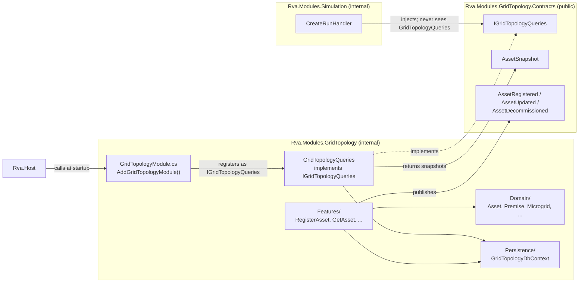

# Module Contracts

How one module uses another without seeing its internals. A module's `.Contracts` project is its **public API**. It **defines** the interfaces, snapshots, and events; the module implementation **implements** them; `Rva.Host` connects the two at runtime through dependency injection.

The example below shows Simulation using GridTopology.

## What goes in a `.Contracts` project

| Kind | Purpose | GridTopology example |
|---|---|---|
| Query interfaces | In-process reads that must be current, including safety-critical ones | `IGridTopologyQueries` |
| Snapshot records | Immutable, read-only copies of data returned by queries; never entities | `AssetSnapshot`, `ProtocolMappingSnapshot` |
| Integration events | Change notifications for modules that keep a local copy of the data | `AssetRegistered`, `AssetUpdated`, `AssetDecommissioned` |

**What stays out:** entities and domain logic, the DbContext and persistence code, feature request/response DTOs, and anything no other module needs.

## Rules

- **The dependency points one way.** The module references its contracts; the contracts never reference the module. A reference back would be circular and would expose the module's internals.
- **A `.Contracts` project references only `Rva.SharedKernel`.** That is why snapshots use shared types like `AssetId` and `Kilowatts`.
- **Each module owns and versions its contracts.** Changing an implementation affects no other module unless the contract changes.

## Contracts vs. feature endpoints

A feature handler and a contract implementation may share the same internal logic, but they serve different callers:

| | Feature endpoint (`Features/GetAsset/`) | Contract (`IGridTopologyQueries`) |
|---|---|---|
| Called by | External clients over HTTP (`Rva.Simulator`, the future dashboard) | Other modules, in the same process |
| Shape | Request/response DTOs local to the feature | Snapshot records from `.Contracts` |
| Lives in | The module implementation | Defined in `.Contracts`, implemented in the module |

## Contracts vs. the shared kernel

- **`Rva.SharedKernel`** holds the vocabulary everyone shares: `AssetId`, `Kilowatts`, `Result`. No module owns it, and a type is added only when a second module needs it.
- **A `.Contracts` project** holds what one module offers: `IGridTopologyQueries`, `AssetRegistered`. That module owns it.
