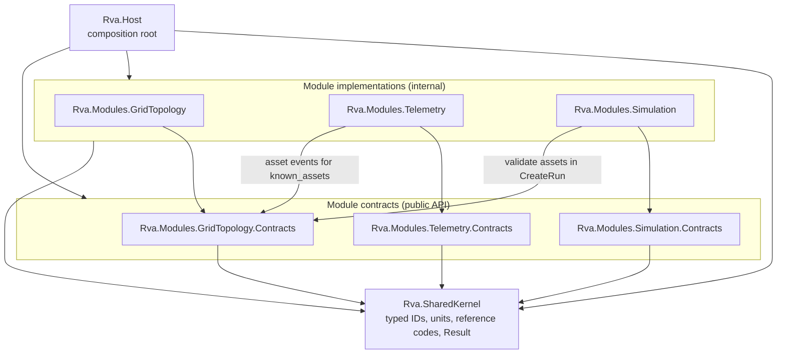

# Module Dependencies

Which projects may reference which. Anything not shown is prohibited, and `tests/Rva.ArchitectureTests` fails the build on a violation.

## Reference rules

| Project | May reference |
|---|---|
| `Rva.Host` | All modules and their `.Contracts`, `Rva.SharedKernel` |
| `Rva.Modules.<X>` | `Rva.SharedKernel`, its own `.Contracts`, other modules' `.Contracts` |
| `Rva.Modules.<X>.Contracts` | `Rva.SharedKernel` only |
| `Rva.SharedKernel` | Nothing outside the .NET base class library |

- **Module implementations never reference each other.** A module that needs another module's data uses that module's `.Contracts`.
- **The cross-module arrows above are the Phase 1 dependencies:** Telemetry and Simulation both depend on GridTopology's contracts. Later modules (for example Dispatch) follow the same pattern.
- **`Rva.Simulator` and `Rva.Intelligence` reference no backend project.** They talk to the backend only over HTTP and MQTT.
