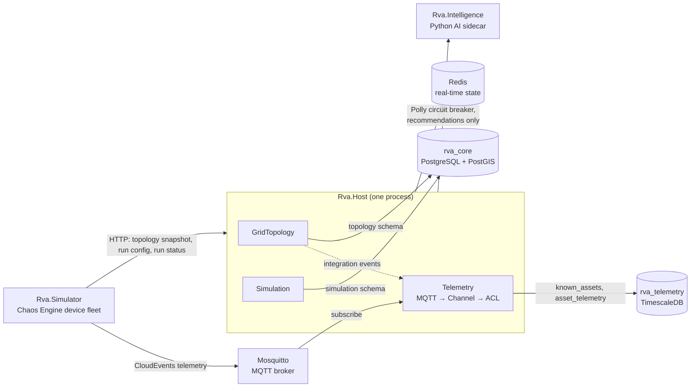

# Runtime View

The processes that run, how they communicate, and where data lives. All backend modules run inside one process, `Rva.Host`. The simulator and the AI sidecar are separate processes.

## Data ownership

Each module owns its storage. No module reads another module's tables, and there are no foreign keys across modules.

| Module | Storage | Owns |
|---|---|---|
| GridTopology | `rva_core`, schema `topology` | Lookups, hardware profiles, grid hierarchy, premises, microgrids, assets, asset components |
| Simulation | `rva_core`, schema `simulation` | Run ledger and per-run asset overrides |
| Telemetry | `rva_telemetry` | `known_assets` (local copy of asset data), `asset_telemetry` (hypertable) |

## Communication rules

- **Inside `Rva.Host`:** modules call each other only through `.Contracts`, either as synchronous queries or as integration events. Safety-critical reads, such as asset power limits, always go through a query and are never served from a cached copy.
- **Simulator to backend:** HTTP for the topology snapshot and run configuration, and MQTT for telemetry. No direct database access.
- **Backend to AI sidecar:** every call goes through a Polly circuit breaker, with a safe default when the sidecar is unhealthy. The sidecar only advises; the C# core decides.
